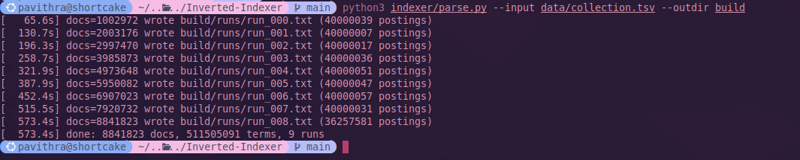

# Inverted-Indexer

## Fetching Data

This project indexes the [MS MARCO passage-ranking](https://ir-datasets.com/msmarco-passage.html) collection (8.8M passages).

```bash
mkdir -p data && cd data

# Passages to collection.tsv
wget https://msmarco.z22.web.core.windows.net/msmarcoranking/collection.tar.gz
tar -xzf collection.tar.gz

# Queries for testing 
wget https://msmarco.z22.web.core.windows.net/msmarcoranking/queries.tar.gz
tar -xzf queries.tar.gz

# Sanity check: should print 8841823
wc -l collection.tsv

# Small subset for development
head -500000 collection.tsv > sample.tsv
```

Each line of `collection.tsv` is `pid<TAB>passage text`.


## Parser to Intermediary

`indexer/parse.py` reads `collection.tsv` in a single streaming pass and writes sorted intermediate postings to disk.

```bash
pip install -r requirements.txt
python3 indexer/parse.py --input data/collection.tsv --outdir build
```

| Option | Default | Description |
|---|---|---|
| `--input` | `data/collection.tsv` | Input TSV (`pid<TAB>text`) |
| `--outdir` | `build` | Output directory |
| `--max-postings` | `40000000` | Postings buffered in memory before a run is flushed |
| `--limit` | none | Parse only the first N passages |

**How it works**
- DocIDs are assigned in read order (0, 1, 2, ...).
- Tokenization is byte-level: lowercase, keep `[a-z0-9]+`, and treat everything else (including non-ASCII) as a separator.
- Postings are buffered as `term -> array('I')` of `(docID, freq)` pairs (8 bytes per posting). When the buffer is full, terms are sorted and flushed as a run.

**Outputs** (in `--outdir`)

| File | Format |
|---|---|
| `runs/run_NNN.txt` | `term docID freq` per line, sorted by (term bytes, docID) |
| `pagetable.bin` | `docID -> (pid, doclen)`, two little-endian `uint32` per doc |
| `meta.txt` | `num_docs`, `total_terms`, `num_runs` |

**Full collection:** 8,841,823 docs, 511.5M terms, about 356M postings in 9 runs. About 9.5 min, and 68 MB page table.


